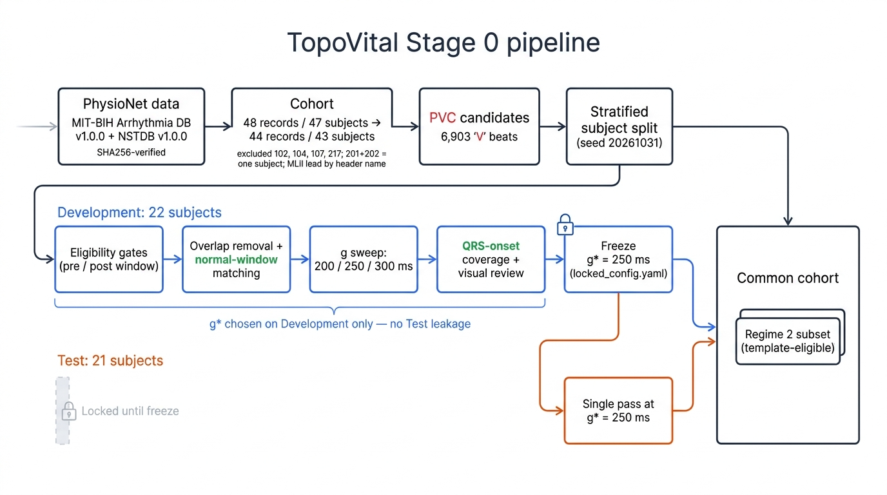
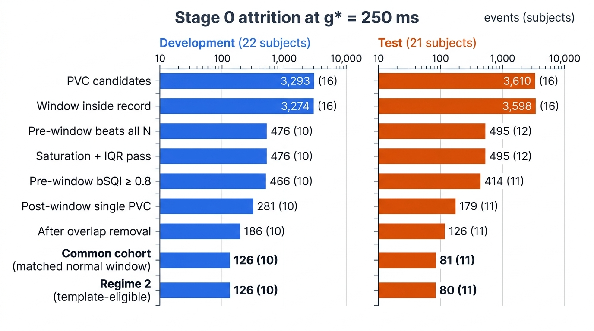
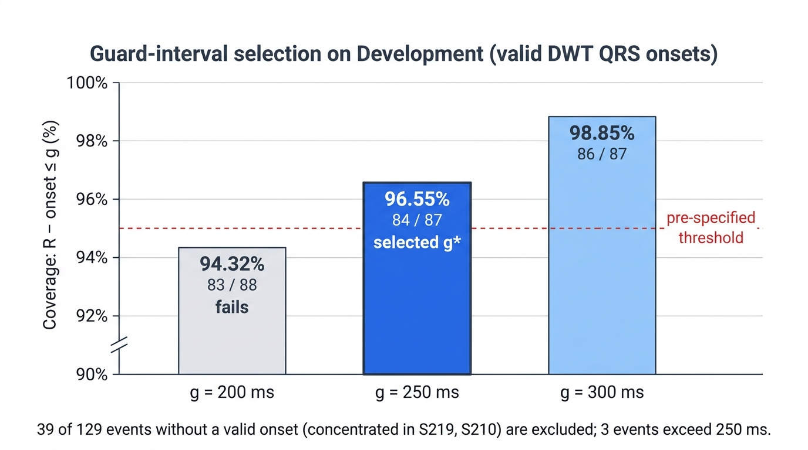
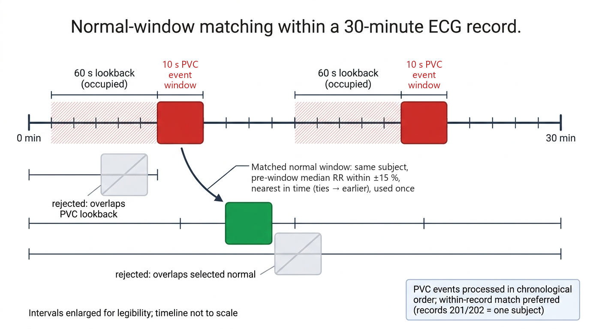

# TopoVital

**Reproducible, CPU-only Stage 0 pipeline for topological analysis of premature ventricular contractions (PVCs) in ECG.**

TopoVital studies whether topological data analysis (persistent homology) can separate a PVC-induced perturbation from
noise, baseline wander, clipping and time-warping artefacts in short ECG windows. This repository implements and
documents **Stage 0** of the experimental protocol: cohort construction, event eligibility, normal-window matching,
guard-interval (`g_star`) selection on Development data only, and a locked Development/Test gate.

> **Status (2026-10-31):** Stage 0 is complete and **frozen** with `g_star = 250 ms`.
> The Test split was processed exactly once with the frozen configuration.
> Persistent-homology features, classifiers and statistical evaluation (protocol §6–§7) are later stages and are not part of this repository yet.

<p align="center">
  
  <br><em>Figure 1. Stage 0 pipeline. The guard interval g* is selected on Development only; Test is locked until the freeze and then processed once.</em>
</p>

---

## Highlights

- **Protocol-first.** Every scientific value lives in [`configs/stage0.yaml`](configs/stage0.yaml), tagged with the protocol clause it comes from (`[P§n]`) or the researcher approval that fixed it (`[APPROVED A-0n]`).
- **No Test leakage.** The guard interval is chosen on Development only. Test aggregation is refused unless a frozen `locked_config.yaml` exists, and the stage-0 config hash and code hash still match. A Test-side `g` sweep is always refused.
- **Branching cohorts.** Template failure never removes an event from the Common cohort (Regimes 1/3); it only excludes the event from the Regime 2 subset.
- **Auditable.** Per-event audit with every gate flag, quality metric and first drop reason. Resource profile (wall time, peak RSS) for every command. SHA256 for all inputs.
- **CPU-only.** No GPU/CUDA/PyTorch/TensorFlow dependency. BLAS/OpenMP threads pinned to 1, record-by-record processing.

## Stage 0 results (MIT-BIH Arrhythmia Database, MLII, `g = 250 ms`)

| Stage | Dev subjects | Dev events | Test subjects | Test events |
|---|---|---|---|---|
| Subjects in split | 22 | – | 21 | – |
| PVC (`V`) candidates | 16 | 3,293 | 16 | 3,610 |
| Window inside record | 16 | 3,274 | 16 | 3,598 |
| Pre-boundary beats all `N` | 10 | 476 | 12 | 495 |
| No ADC saturation, IQR ≥ 1e-4 mV | 10 | 476 | 12 | 495 |
| Pre-boundary bSQI ≥ 0.8 | 10 | 466 | 11 | 414 |
| Post-boundary single isolated `V`, no saturation / signal loss | 10 | 281 | 11 | 179 |
| After overlap removal (≥ 10 s separation) | 10 | 186 | 11 | 126 |
| **Common cohort** (matched normal window) | **10** | **126** | **11** | **81** |
| **Regime 2** (≥ 10 template beats) | **10** | **126** | **11** | **80** |

<p align="center">
  
  <br><em>Figure 2. Stage 0 attrition at g* = 250 ms: events (subjects) per gate, log scale.</em>
</p>

Cohort: 48 records / 47 subjects → 44 records / 43 subject groups after excluding records 102, 104, 107 and 217. Records 201 and 202 are treated as one subject.
Split: subject-grouped and stratified by step-1 PVC count (strata 0 / 1–88 / > 88), with seed `20261031`.

**Guard-interval selection (Development, valid DWT onsets):**

| g | Coverage of R − onset ≤ g | Meets 95%? |
|---|---|---|
| 200 ms | 83 / 88 = 94.32 % | no |
| **250 ms** | **84 / 87 = 96.55 %** | **yes (smallest)** |
| 300 ms | 86 / 87 = 98.85 % | yes |

<p align="center">
  
  <br><em>Figure 3. Guard-interval selection on Development. 250 ms is the smallest candidate above the pre-specified 95 % threshold.</em>
</p>

**Known limitations** (recorded in [`configs/g_decision_reviewed.yaml`](configs/g_decision_reviewed.yaml)):
- 39 of 129 Development events (30 %) had no valid DWT onset; these are concentrated in S219 and S210.
- Three events exceed 250 ms (116_164994, 116_302281, 219_365144). `g` mitigates QRS boundary cutting but does not guarantee to eliminate it.
- Events are concentrated in a few subjects.

Full numbers are in [`outputs/attrition_summary.csv`](outputs/attrition_summary.csv) and [`outputs/stage0_report.md`](outputs/stage0_report.md). Every decision and deviation is logged in [`outputs/implementation_decisions.md`](outputs/implementation_decisions.md).

## Installation

Developed and tested on Python 3.14 (Windows 11). Other Python versions have not been verified.

```bash
git clone https://github.com/justinbrianhwang/TopoVital.git
cd TopoVital
python -m venv .venv
# Windows
.venv\Scripts\python -m pip install -r requirements.lock.txt
# Linux / macOS
.venv/bin/python -m pip install -r requirements.lock.txt
```

[`requirements.txt`](requirements.txt) lists the direct dependencies. [`requirements.lock.txt`](requirements.lock.txt) pins the exact versions that were installed and import-verified, including numpy, scipy, pandas, pyarrow, wfdb 4.3.1, neurokit2 0.2.13, gudhi 3.13.0 and scikit-learn.

## Data

The raw data are **not** included. Download the official ZIP archives from PhysioNet (no credentials required) into `data/`:

| Dataset | Version | Save as |
|---|---|---|
| [MIT-BIH Arrhythmia Database](https://physionet.org/content/mitdb/1.0.0/) | 1.0.0 | `data/mitdb-1.0.0.zip` |
| [MIT-BIH Noise Stress Test Database](https://physionet.org/content/nstdb/1.0.0/) | 1.0.0 | `data/mit-bih-noise-stress-test-database-1.0.0.zip` |

`python -m topovital fetch` extracts them into `data/raw/`. It never overwrites existing files, and it verifies every file against the distribution's own `SHA256SUMS.txt`. Only the raw NSTDB noise records `bw`, `ma` and `em` are used; the pre-mixed `118e*/119e*` records are not.

## Usage

```bash
python -m topovital env-check                        # environment.json + requirements.lock.txt
python -m topovital fetch                            # extract + SHA256 verification
python -m topovital cohort                           # 48/47 -> 44/43, MLII by header name, step-1 PVC list
python -m topovital split                            # stratified 22/21 subject split (immutable)
python -m topovital stage0 --split development --g-sweep
python -m topovital freeze-stage0 --decision configs/g_decision_reviewed.yaml
python -m topovital stage0 --split test --config outputs/locked_config.yaml
python -m topovital report-stage0
python -m pytest -q
```

A command that is not allowed in the current state exits with code `3` and prints the reason. For example, a Test run before freezing, or any Test `g` sweep. Each command appends a row to `outputs/resource_profile.csv`.
On real data the Development sweep took about 230 s with a peak RSS of about 420 MB on a 10-core / 32 GB CPU machine.

## Method summary (Stage 0)

1. **Candidates:** every `V` beat annotation on the 44 retained records. The 10 s window has its boundary at `t0 = 5 s` and the target R peak at `t0 + g`.
2. **Pre-boundary `[0, t0)`:** all beat annotations are `N`. There must be no run of ≥ 3 samples at the digital ADC limits 0/2047. `IQR ≥ 1e-4 mV`. `bSQI ≥ 0.8`, where bSQI compares `wfdb.processing.xqrs_detect` and NeuroKit2 Pan–Tompkins detections after a 0.5–40 Hz 4th-order Butterworth band-pass (zero-phase), with greedy one-to-one matching within ±150 ms.
3. **Post-boundary `[t0, W)`:** exactly one `V` (the target) and all other beats `N`. No saturation and no annotated signal loss.
4. **Overlap removal:** chronological; the earlier event is kept and the next one needs a separation of at least 10 s. **Normal matching:** a clean 10 s window from the same subject is used once. Its pre-boundary median RR must be within ±15 % of the event's. It may not overlap any PVC window together with that window's 60 s lookback, nor any other selected normal window. The nearest window in time is chosen, and ties go to the earlier window.
5. **Common cohort** = matched pairs. **Regime 2** = the subset with ≥ 10 normal template beats in a 60 s lookback whose `[−250, +450] ms` windows end before `t0`.
6. **Guard interval:** NeuroKit2 DWT QRS onset on Development only. `g_star` is the smallest `g ∈ {200, 250, 300} ms` for which ≥ 95 % of valid onsets satisfy `R − onset ≤ g`, confirmed by visual waveform review.

<p align="center">
  
  <br><em>Figure 4. Normal-window matching (step 4). Schematic, not to scale.</em>
</p>

## Repository layout

```
assets/figs/   README figures
configs/      stage0.yaml (all Stage 0 settings), g-decision records
topovital/    pipeline package
tests/        unit + real-data reproducibility tests (pytest)
outputs/      Stage 0 deliverables: cohort_manifest.csv, event_audit*.parquet, attrition_summary.csv,
              locked_config.yaml, implementation_decisions.md, stage0_report.md, resource_profile.csv, ...
```

## License and data attribution

The code is licensed under the [Apache License 2.0](LICENSE). Copyright © 2026 Sunjun Hwang.

The MIT-BIH Arrhythmia Database and the MIT-BIH Noise Stress Test Database are distributed by PhysioNet under the Open Data Commons Attribution License v1.0. If you use them, please cite:

- Moody GB, Mark RG. The impact of the MIT-BIH Arrhythmia Database. *IEEE Eng Med Biol* 20(3):45–50 (2001).
- Moody GB, Muldrow WE, Mark RG. A noise stress test for arrhythmia detectors. *Computers in Cardiology* 11:381–384 (1984).
- Goldberger AL, et al. PhysioBank, PhysioToolkit, and PhysioNet. *Circulation* 101(23):e215–e220 (2000).

